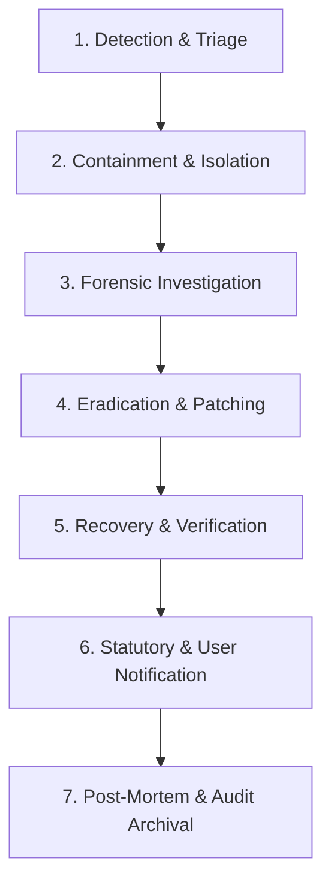

# Orange Taxi — Incident Response Plan & Data Breach Procedure
**Document Version:** 2.4 &bull; **Effective Date:** October 15, 2026  
**Classification:** Confidential &bull; Operational Security Procedure  
**Governing Laws:** Digital Personal Data Protection (DPDP) Act, 2023 &bull; CERT-In Cybersecurity Directions (2022) &bull; Motor Vehicle Aggregator Guidelines (2020)

---

## 1. Purpose & Scope

This Incident Response Plan (IRP) defines the mandatory technical and operational procedures for detecting, containing, investigating, and reporting cybersecurity incidents or personal data breaches affecting **Orange Taxi Electric Mobility Solutions Pvt. Ltd.** (&ldquo;Orange Taxi&rdquo;).

It covers all data repositories, server runtimes, progressive web apps, chauffeur/rider mobile applications, Supabase PostgreSQL databases, and third-party integrations (Razorpay, Google Maps, Resend, Cloudflare).

---

## 2. Incident Response Team (IRT) & Escalation Hierarchy

| Role | Primary Responsibility | Contact Channel |
| :--- | :--- | :--- |
| **Incident Commander (IC)** | Coordinates response, approves containment actions, and leads post-incident reviews. | `security-lead@orange-taxi.com` |
| **Lead Security Engineer** | Forensic analysis, log triage, patch development, and database/network containment. | `secops@orange-taxi.com` |
| **Data Protection Officer (DPO)** | Assesses legal exposure, coordinates statutory notifications to CERT-In and DPBI. | `privacy@orange-taxi.com` |
| **Fleet Operations Lead** | Chauffeur and driver partner communications, fleet safety coordination. | `fleet-ops@orange-taxi.com` |
| **Customer Support Lead** | Passenger communications and helpdesk escalation. | `support@orange-taxi.com` |

---

## 3. Incident Severity Classification Matrix

| Severity Level | Criteria & Impact | Response SLA | Regulatory Reporting |
| :--- | :--- | :--- | :--- |
| **P1 — Critical** | Unauthorized access or exfiltration of sensitive personal data (KYC documents, DL/Aadhaar, live telemetry), compromised production database keys, or mass unauthorized fare/payment tampering. | **Immediate (&le; 15 mins)** | **Mandatory &le; 6 hours** to CERT-In and DPBI. |
| **P2 — High** | Unauthorized alteration of single-user bookings, failed brute-force attacks against admin accounts, or privilege escalation attempts caught before data exfiltration. | **&le; 1 hour** | Assess if personal data exposure occurred. |
| **P3 — Medium** | Anomalous login spikes, partial outage of external sub-processor, or non-PII software bug. | **&le; 4 hours** | Internal documentation only. |
| **P4 — Low** | Isolated client-side error, minor cosmetic defect, or spam attempt blocked by firewalls. | **&le; 24 hours** | Routine sprint review. |

---

## 4. Technical Incident Handling Lifecycle



### Stage 1: Detection & Triage
- Events are captured in `public.security_audit_logs` without storing passwords, credit card numbers, or authorization tokens.
- Automatic alerts trigger on:
  - Unauthorized booking modifications (`check_booking_update_integrity` trigger violations).
  - High-frequency failed login attempts against Supabase Auth.
  - Role elevation attempts (`role.elevated` or admin RPC calls).
- The IC convenes the IRT and assigns an incident tracking code (e.g., `INC-2026-1015-01`).

### Stage 2: Immediate Containment
1. **Compromised Sessions**: Revoke active user or admin sessions immediately via Supabase Auth Admin API:
   ```typescript
   await supabase.auth.admin.signOut(targetUserId);
   ```
2. **API Key Revocation**: If third-party keys (Resend, Razorpay, Google Maps) are exposed, immediately rotate them in provider portals and deploy updated secrets to Cloudflare/environment variables.
3. **Database Guardrails**: If unauthorized updates are detected, switch the affected table to read-only or terminate suspect connections via PostgreSQL administration:
   ```sql
   ALTER TABLE public.bookings DISABLE TRIGGER trg_booking_update_integrity; -- Only for emergency repair
   ```

### Stage 3: Forensic Investigation & Query Recipes
Identify the scope of exposure and affected user IDs using non-destructive audit queries:

```sql
-- 1. Review security violations in the last 24 hours
SELECT id, event_type, severity, user_id, ip_address, metadata, created_at
FROM public.security_audit_logs
WHERE created_at >= NOW() - INTERVAL '24 hours'
ORDER BY created_at DESC;

-- 2. Identify bookings altered during suspect window
SELECT id, reference, customer_id, driver_id, status, payment_status, estimated_fare, final_fare, updated_at
FROM public.bookings
WHERE updated_at >= NOW() - INTERVAL '6 hours'
  AND (payment_status = 'paid_online' OR estimated_fare < 50)
ORDER BY updated_at DESC;

-- 3. Verify driver KYC documents uploaded in suspect window
SELECT name, bucket_id, created_at, metadata
FROM storage.objects
WHERE bucket_id = 'driver_kyc'
  AND created_at >= NOW() - INTERVAL '24 hours';
```

### Stage 4: Eradication & Patching
- Deploy code or RLS policy hotfixes to staging, execute regression test suites, and merge to `main`.
- Invalidate all cached data in Cloudflare CDN.

### Stage 5: Recovery & Verification
- Verify database integrity and test positive and negative access permissions.
- Validate that all application routes (`/book`, `/admin`, `/driver-console`) function normally under least-privilege rules.

---

## 5. Statutory Reporting Mandates & Timelines

### Indian Computer Emergency Response Team (CERT-In)
- **Mandate:** Cyber Security Directions under Section 70B of the Information Technology Act, 2000.
- **Reporting Deadline:** **Within 6 hours** of notice or becoming aware of cybersecurity incidents (including data breaches, unauthorized database access, denial-of-service, or ransomware).
- **Incident Reporting Portal:** `https://www.cert-in.org.in` &bull; **Email:** `incident@cert-in.org.in`

### Data Protection Board of India (DPBI)
- **Mandate:** Section 8(6) of the Digital Personal Data Protection (DPDP) Act, 2023.
- **Reporting Requirement:** In the event of a personal data breach, Orange Taxi as Data Fiduciary must give intimation of such breach to the Board and each affected Data Principal in the prescribed form and manner.

---

## 6. Official Notification Templates

### Template A: Statutory Incident Disclosure to CERT-In / DPBI

```text
To: incident@cert-in.org.in / Data Protection Board of India
Subject: URGENT: Cybersecurity Incident / Personal Data Breach Report — Orange Taxi Electric Mobility Solutions Pvt. Ltd.
Date: [Insert Date & Time IST]

1. ORGANIZATION IDENTIFIERS:
   - Entity Name: Orange Taxi Electric Mobility Solutions Pvt. Ltd.
   - Service: On-demand electric taxi aggregation and fleet operations
   - Website: https://orange-taxi.com
   - Contact Person: Rajesh Kumar, Data Protection Officer (privacy@orange-taxi.com)

2. INCIDENT DETAILS:
   - Date & Time of Occurrence: [YYYY-MM-DD HH:MM IST]
   - Date & Time of Detection: [YYYY-MM-DD HH:MM IST]
   - Incident Classification: [e.g., Unauthorized Database Access / Compromised API Credential / Data Exfiltration]
   - Impacted Systems: [e.g., PostgreSQL Bookings Table / Supabase Storage Bucket / Cloudflare Edge]

3. SCOPE OF PERSONAL DATA AFFECTED:
   - Number of Affected Data Principals: [Exact count or estimated range]
   - Categories of Data: [e.g., Rider Names, Phone Numbers, Trip Coordinates, Chauffeur KYC DL Details]
   - Financial Data Impact: Nil. No payment card details are stored; payments are tokenized via Razorpay.

4. CONTAINMENT & MITIGATION ACTIONS TAKEN:
   - [e.g., Compromised API tokens were revoked within 20 minutes of detection.]
   - [e.g., Row Level Security policies were tightened; database write access was restricted.]
   - [e.g., Impacted user authentication sessions were terminated.]

5. CURRENT OPERATIONAL STATUS:
   - Status: [Contained / Under Forensic Investigation / Systems Fully Restored]
   - Forensic Logs: Preserved in secure offline storage for CERT-In inspection.

Submitted by:
Rajesh Kumar, Data Protection Officer
Orange Taxi Electric Mobility Solutions Pvt. Ltd.
```

---

### Template B: Notice of Personal Data Breach to Affected Users

```text
Subject: Important Security Notice Regarding Your Orange Taxi Account

Dear [Passenger Name / Chauffeur Name],

At Orange Taxi, the privacy, confidentiality, and security of your personal data are our utmost priority. We are writing to inform you about a security incident that may have involved some of your personal information, the immediate actions we took, and what you should know.

1. WHAT HAPPENED:
On [Insert Date], our automated security monitoring detected unauthorized access to [describe system, e.g., an internal database table containing ride records]. Our security team contained the incident within [X] minutes and blocked all further unauthorized requests.

2. WHAT INFORMATION WAS INVOLVED:
Our investigation confirms that the following details associated with your account were affected:
- [List data categories: e.g., Name, Mobile Number, and Pickup/Drop-off addresses for past trips].

CRITICAL FINANCIAL NOTICE:
Your passwords, payment cards, bank account details, and UPI PINs were NOT involved. Orange Taxi does not store credit/debit card numbers or payment credentials on its servers.

3. ACTIONS WE HAVE TAKEN:
- We immediately patched the vulnerability and updated our database access policies.
- All active user sessions were invalidated to prevent session hijacking.
- We reported this incident to the relevant regulatory authorities (CERT-In and the Data Protection Board of India) in compliance with the DPDP Act, 2023.

4. WHAT YOU CAN DO:
- As a precaution, we recommend updating your password when you next sign in to your Orange Taxi account.
- Remain vigilant against unsolicited communications or phone calls asking for sensitive financial information or OTPs. Orange Taxi chauffeurs and support staff will NEVER ask for your password or banking OTP.

5. FOR MORE INFORMATION:
If you have questions or concerns regarding this notice, our dedicated Data Protection Officer is available:
- Email: privacy@orange-taxi.com
- Grievance Portal: https://orange-taxi.com/privacy

Sincerely,
The Orange Taxi Security & Privacy Team
Orange Taxi Electric Mobility Solutions Pvt. Ltd.
```

---

## 7. Compliance Verification & Log Preservation

1. **Log Integrity**: System and audit logs must be retained for at least **180 days** on secure, tamper-evident storage in accordance with CERT-In directions.
2. **Post-Mortem Documentation**: Within **7 calendar days** of incident closure, the Incident Commander must publish a formal Post-Incident Report outlining root cause, timeline, containment efficacy, and permanent preventative measures.
