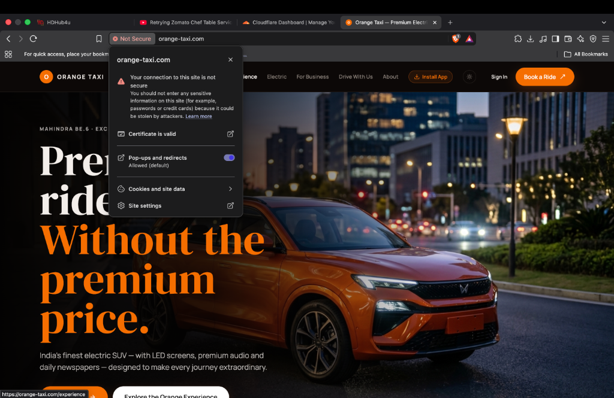
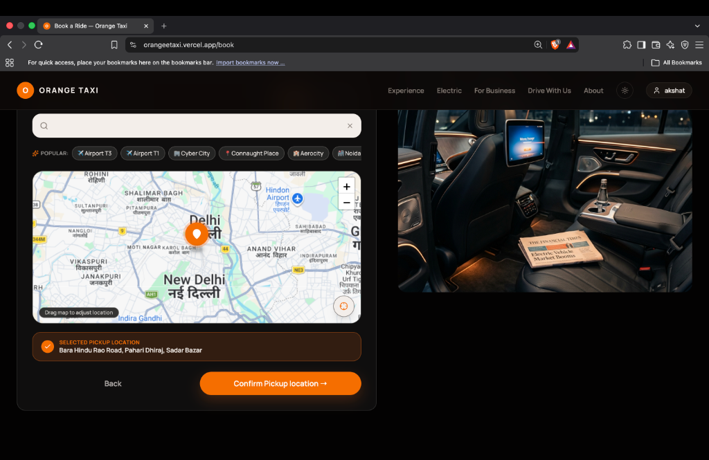
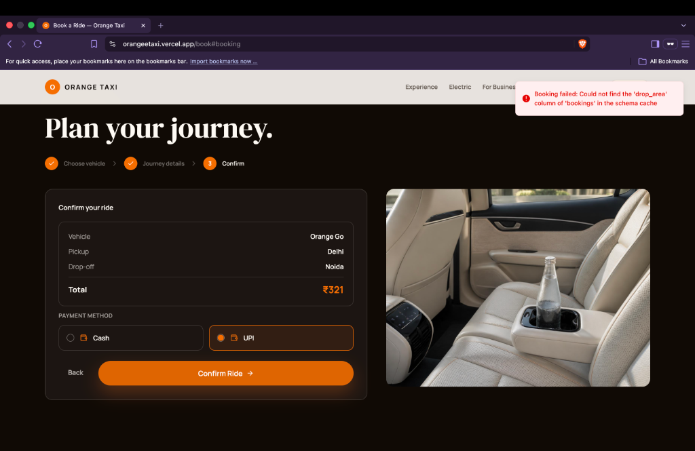
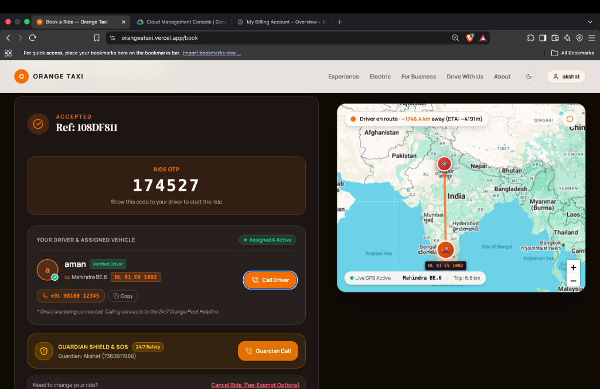
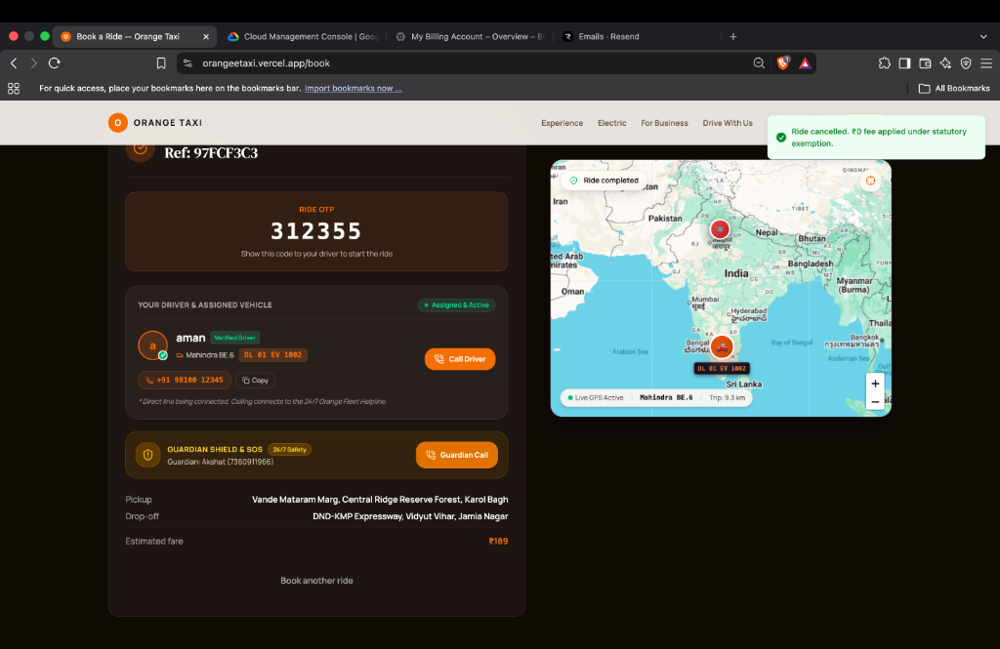
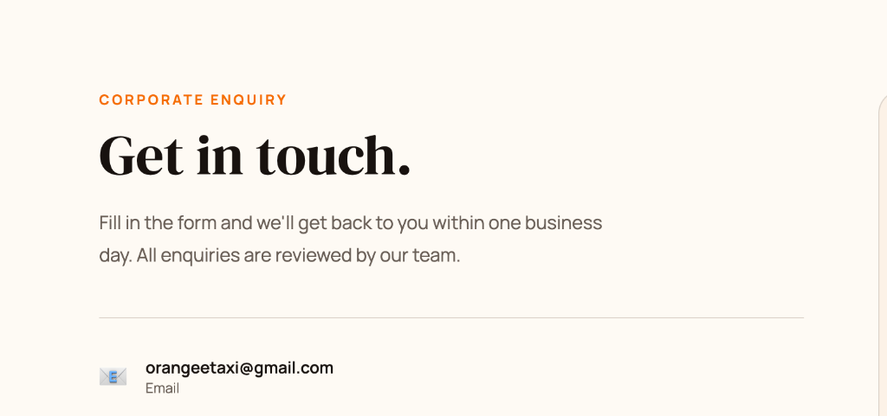
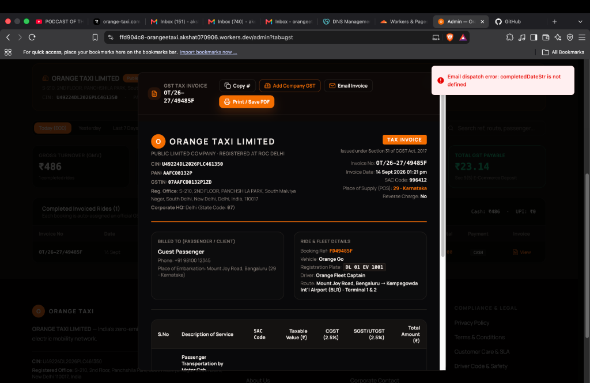

# 🟠 Orange Taxi

**Delhi NCR's 100% Electric Cab Fleet** — Premium rides, without the premium price.

> India's finest electric SUV fleet with professional chauffeurs, pre-cooled cabins, complimentary water, and real-time booking tracking.

🌐 **Live:** [orange-taxi.com](https://orange-taxi.com) &nbsp;·&nbsp; 📞 **24x7 Helpline:** 011 4000 7000 &nbsp;·&nbsp; ✉️ bookings@orange-taxi.com

---

## 📸 Screenshots

### Homepage — Hero



---

### Homepage — Book Your Orange


---

### Booking — Pickup Location & Map



---

### Booking — Confirm Your Ride



---

### Active Ride — Live Driver Tracking



_Real-time GPS map, driver details, Ride OTP, Guardian SOS, and live ETA_

---

### Ride Completed



---

### Corporate Enquiry



---

### Admin — GST Tax Invoice



---

## ✨ Features

### 🧑‍💼 Passenger

- **Instant booking** with GPS map-picker for pickup and drop
- **Real-time ride tracking** with live driver GPS on map
- **Ride OTP** authentication to start the ride
- **Guardian Shield & SOS** — safety contact notified on trip start
- **Live chat** with assigned driver
- **GST tax invoices** emailed after each ride
- **Customer profile** with full ride history and stats
- **PWA** — installable on Android & iOS with background push notifications
- **Zero cancellation fee** under statutory exemption

### 🚗 Driver Console

- Real-time incoming ride request alerts (audio chime + OS notification)
- Accept, mark arrived, start ride, and complete with a single tap
- Live GPS location broadcasting
- OTP-verified ride start
- Daily earnings dashboard (cash + UPI)
- Commission settlement tracking
- Driver chat with passenger

### 🛡️ Admin Dashboard

- Full bookings management with GST invoice generation & email dispatch
- Driver application review and onboarding approval
- Service area and vehicle category configuration
- Dynamic pricing settings
- Commission and settlement ledger
- User role management

### 🔔 PWA Web Push Notifications

- Background arrival alerts: _"Your Orange Chauffeur has arrived at your gate 📍"_
- Works on Android (system tray) and iOS (home screen PWA)
- Audio chime (Web Audio API) + haptic vibration on mobile
- Service Worker handles offline caching and notification clicks

---

## 🏗️ Tech Stack

| Layer                   | Technology                                        |
| :---------------------- | :------------------------------------------------ |
| **Frontend**            | React 18, TanStack Router, TanStack Start (SSR)   |
| **Styling**             | Tailwind CSS v4, shadcn/ui, Radix UI              |
| **Backend / DB**        | Supabase (PostgreSQL + Realtime + Auth + Storage) |
| **Deployment**          | Cloudflare Workers + Pages                        |
| **Maps**                | Google Maps JavaScript API                        |
| **PWA**                 | Service Worker, Web Push, Web Audio API           |
| **Transactional Email** | Resend (AWS SES)                                  |
| **Payments**            | Cash + UPI (manual settlement)                    |
| **Language**            | TypeScript                                        |

---

## 🚀 Getting Started

```bash
# Clone the repository
git clone https://github.com/akshat0709/orangeetaxi.git
cd orangeetaxi

# Install dependencies
npm install

# Set up environment variables
cp .env.example .env.local
# Add: VITE_SUPABASE_URL, VITE_SUPABASE_ANON_KEY, VITE_GOOGLE_MAPS_API_KEY

# Start development server
npm run dev
```

---

## 📁 Project Structure

```
orangeetaxi/
├── public/
│   ├── sw.js                 # Service Worker (PWA + Push Notifications)
│   └── manifest.webmanifest
├── src/
│   ├── routes/
│   │   ├── index.tsx          # Homepage
│   │   ├── book.tsx           # Booking flow (4-step)
│   │   ├── track.tsx          # Public ride tracker
│   │   ├── profile.tsx        # Customer profile + ride history
│   │   ├── driver-console.tsx # Driver app
│   │   └── admin.tsx          # Admin dashboard
│   ├── components/
│   │   ├── notification-banner.tsx   # PWA permission banner
│   │   ├── live-ride-map.tsx         # Real-time GPS map
│   │   ├── guardian-safety-modal.tsx
│   │   └── ride-chat-sheet.tsx
│   └── lib/
│       ├── notifications.ts   # Push notification engine
│       ├── ride-vehicle.ts
│       └── ride-preferences.ts
├── plan/                      # Original product brief & vision
└── docs/
    └── screenshots/           # Website screenshots
```

---

## 🌍 Service Areas

Currently operating in **Delhi NCR** covering:

- Delhi (Central, South, North, East, West)
- Gurugram (Cyber City, DLF, Golf Course Road)
- Noida (Sectors 18, 62, 125, 135)
- Faridabad, Ghaziabad
- IGI Airport T1, T2, T3

---

## 📄 Legal

- **Company:** Orange Taxi Limited — CIN: U49224DL2026PLC461350
- **GSTIN:** 07AAFC00132P1ZD · **PAN:** AAFC00132P
- **Registered Office:** S-210, 2nd Floor, Panchshila Park, South Malviya Nagar, New Delhi 110017

---

## 📞 Contact

|                |                           |
| :------------- | :------------------------ |
| **Bookings**   | bookings@orange-taxi.com  |
| **Corporate**  | business@orange-taxi.com  |
| **Support**    | support@orange-taxi.com   |
| **Helpline**   | +91 11 4000 7000          |
| **Grievances** | grievance@orange-taxi.com |
